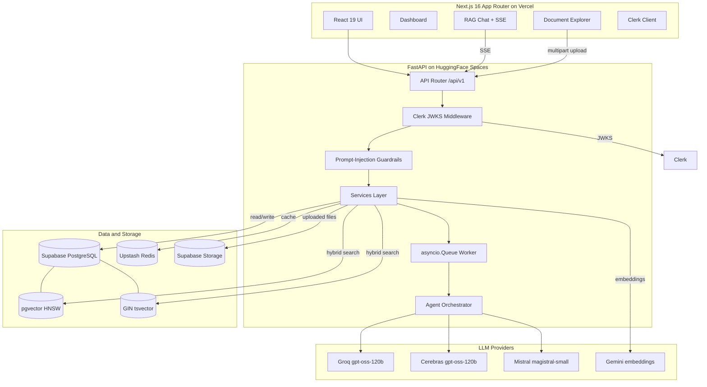
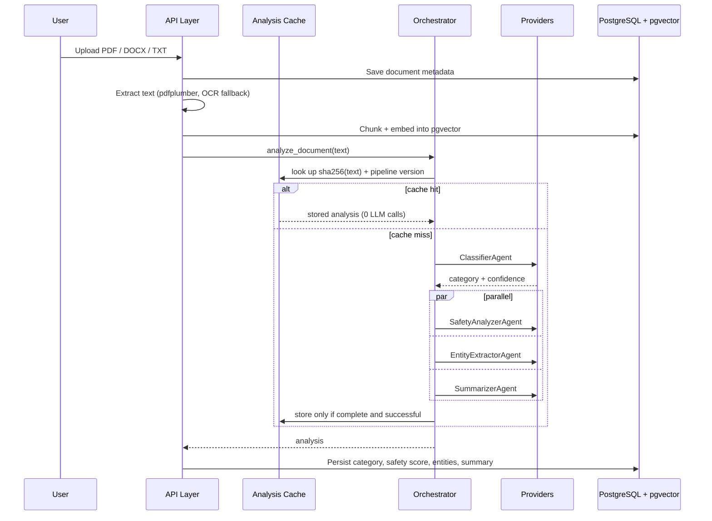
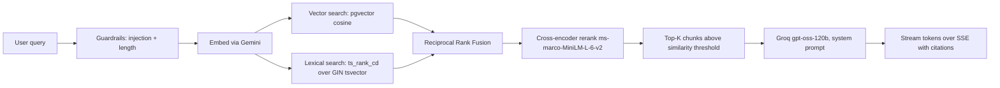

# MiningNiti Architecture

MiningNiti is a document intelligence and RAG chat platform for the mining
industry. Uploaded documents are classified, screened for hazards, mined for
entities and summarised by a group of specialised agents; the resulting chunks
are embedded into pgvector and served back through a hybrid-retrieval chat that
cites the document and page behind every claim.

## High-Level System Architecture

## Agents

Five agents exist. Four run on every upload; the fifth runs only when a
compliance audit is created.

| Agent | Provider / model | When it runs |
|---|---|---|
| Classifier | Groq `openai/gpt-oss-120b` | Upload, first — its category feeds the others |
| Safety Analyzer | Mistral `magistral-small-latest` | Upload, in parallel (skipped for non-safety categories) |
| Entity Extractor | Cerebras `gpt-oss-120b` | Upload, in parallel |
| Summarizer | Cerebras `gpt-oss-120b` | Upload, in parallel |
| Compliance Auditor | Groq `openai/gpt-oss-120b` | On demand, from `compliance_service.py` |

Retry and provider fallback live in `BaseAgent._generate_json` only. The
classifier and compliance auditor fall back to Cerebras when Groq rate-limits,
because Groq's free tier (8K tokens/minute) is the tightest budget in the system
and Cerebras serves the identical model at 30K/minute.

## Document Processing

A failed or partial analysis is never cached, so re-analysing a document that
hit a rate limit genuinely re-runs the agents.

## RAG Chat

The lexical arm is PostgreSQL full-text search, not BM25 and no longer
`pg_trgm` — trigram similarity scored short questions too low to be useful. See
the history note at the top of `app/services/hybrid_search.py`.

## Retrieval Quality Gate

Retrieval is scored against a labelled golden set of 12 queries over a
130-chunk corpus, and runs in CI as a blocking gate using a local
sentence-transformers model so it needs no API keys.

| Metric | Floor | Current |
|---|---|---|
| Hit Rate@5 | 0.90 | 1.000 |
| MRR | 0.75 | 1.000 |
| Recall@5 | 0.85 | 0.958 |
| nDCG@5 | 0.75 | 0.968 |

Generation quality (faithfulness, relevancy) is judged by Gemini and run on
demand rather than in CI, because it needs an API key.

## Security and Access Control

- **Authentication**: Clerk JWTs, verified server-side against Clerk's JWKS.
- **Data isolation**: every document, chat and analytics query filters by
  `user_id` taken from the JWT `sub` claim.
- **Guardrails**: queries over 1500 characters or matching any of ~20 prompt
  injection patterns are rejected before reaching retrieval.
- **Rate limiting**: 120 requests/minute per IP via slowapi.

## Deployment

- **Frontend**: Vercel.
- **Backend**: Docker image on HuggingFace Spaces, deployed by
  `.github/workflows/deploy.yml` on pushes to `main` touching `backend/**`.
  Alembic migrations run at container start, before the server binds.
- **Database**: Supabase PostgreSQL with `pgvector` and `pg_trgm`.
- **Cache**: Upstash Redis (optional — everything degrades to a no-op without it).
- **Uploads**: Supabase Storage. Without `SUPABASE_URL` configured, uploaded
  files are lost on every container restart.

Total infrastructure cost: $0/month, all free tiers.

## Architectural Refactoring: The 5-Pillar Modernization

The codebase was comprehensively refactored across five architectural pillars to enforce strict type safety, eliminate dead code, unify dual execution paths, consolidate document extraction, and centralize environment configuration:

1. **Pillar 1: Schema-Driven Multi-Agent Execution (`app/schemas/agents.py`, `app/agents/`)**
   - Replaced brittle ad-hoc dictionaries and raw regex parsers with typed Pydantic v2 schemas: `ClassifierOutput`, `HazardItem`, `SafetyAnalyzerOutput`, `EntityExtractorOutput`, and `SummarizerOutput`.
   - Built a generic `BaseAgent._generate_structured(schema)` method supporting resilient fallback, schema validation, and automatic coercion (e.g. converting plain LLM hazard strings into structured `HazardItem` models).

2. **Pillar 2: Dead Code & Redundant Alias Pruning (`app/agents/base.py`, `app/services/hybrid_search.py`)**
   - Pruned obsolete regex JSON parser `_parse_json()` in favor of direct Pydantic JSON validation.
   - Removed the misleading alias `bm25_search = fulltext_search` in `hybrid_search.py`, clarifying that lexical search is backed by PostgreSQL `tsvector` and `ts_rank_cd`.
   - Unified the canonical citation contract across models (`total_pages` and `page_numbers`).

3. **Pillar 3: Unified Chat & Streaming Pipeline (`app/services/chat_service.py`, `app/api/v1/chat*.py`)**
   - Eliminated diverging logic between synchronous (`/chat/send`) and streaming (`/chat/stream`) endpoints by introducing `ChatTurnContext`, `ChatService.prepare_turn()`, and `ChatService.finalize_turn()`.
   - Enforced complete parity: prompt-injection guardrails, anti-echo history replay isolation, user turn persistence, assistant message persistence, citation formatting, audit logging, and response latency tracking now run identically in both paths.

4. **Pillar 4: Consolidating Document Extractors & OCR (`app/services/extractors.py`, `pdf_layout.py`)**
   - Replaced scattered extraction helpers with an object-oriented `BaseExtractor(ABC)` hierarchy (`PDFExtractor`, `DocxExtractor`, `PlainTextExtractor`, `ImageExtractor`) managed by a polymorphic `get_extractor(file_type)` registry.
   - Added format-agnostic pagination approximation (`_approximate_pages()`) so non-PDF files (DOCX, TXT, Images) produce queryable page-level citations.
   - Fixed binary image byte corruption by introducing `ocr_image()` with direct `Image.open(BytesIO)` processing.
   - Enhanced table layout extraction with Markdown splitting that repeats header rows across chunk boundaries.

5. **Pillar 5: Centralizing Configuration & Environment Management (`app/config.py`, `backend/.env.example`)**
   - Implemented dynamic string-to-list parsing (`mode="before"`) for `CORS_ORIGINS`, `CLERK_AUTHORIZED_PARTIES`, and `ALLOWED_FILE_TYPES` supporting both JSON arrays and comma-separated strings.
   - Aligned `ALLOWED_FILE_TYPES` with image MIME types (`image/png`, `image/jpeg`, etc.).
   - Added fail-fast boundary validation for `SIMILARITY_THRESHOLD` ($0.0 \le v \le 1.0$), `CHUNK_OVERLAP` ($< \text{CHUNK\_SIZE}$), and positive pool/chunk sizes.
   - Updated `.env.example` to authoritatively document all 37 settings while pruning legacy dead keys.

## Known Limits

- Database access is synchronous SQLAlchemy inside async endpoints, so
  throughput per worker is bounded.
- The background queue is an in-process `asyncio.Queue`: queued work does not
  survive a restart and does not scale across replicas.
- Agents receive the document head and tail (~15K characters), not the full
  text, so very long documents are analysed from an excerpt.
