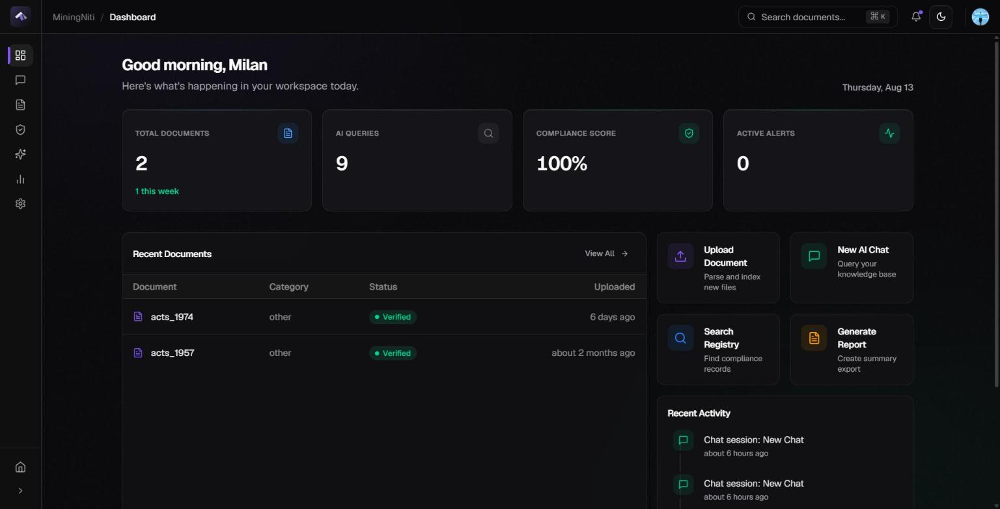
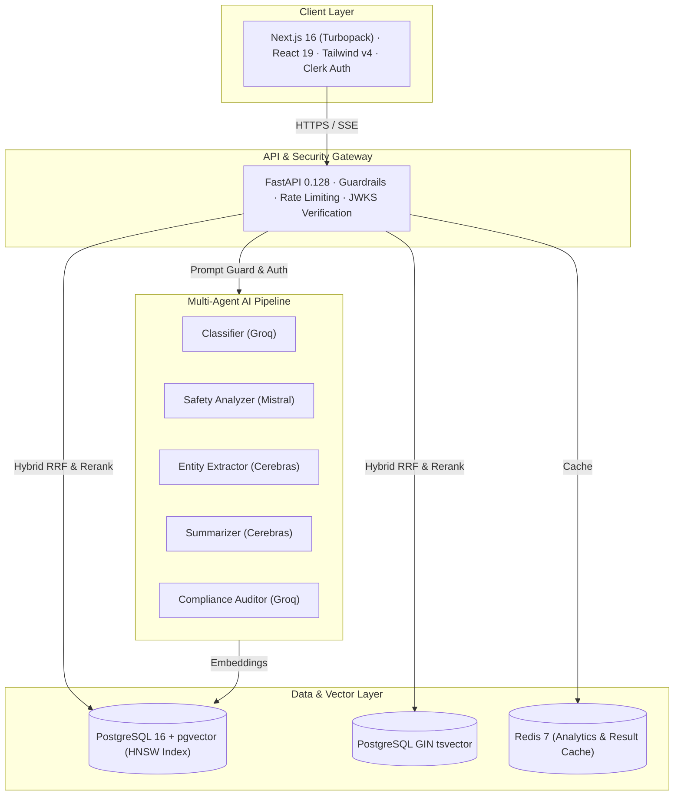

<div align="center">

# MiningNiti

### Enterprise AI Document Intelligence & Compliance for Coal Mining

[](https://python.org)
[](https://fastapi.tiangolo.com)
[](https://nextjs.org)
[](https://react.dev)
[](https://github.com/pgvector/pgvector)
[](LICENSE)

[Live Demo](https://miningniti.vercel.app) · [Interactive API Docs (Swagger)](http://localhost:8000/docs) · [Architecture Guide](ARCHITECTURE.md) · [Agent Specs](AGENTS.md)

<br/>

> 🏆 **Smart India Hackathon 2023 — National Winner**  
> Problem Statement by the **Ministry of Coal**, recognized by **Coal India Limited** and **CMPDI**.  
> *(Successor rebuild: An independent production-grade system engineered from the ground up).*

</div>

---

## 📌 Overview

**MiningNiti** is a production AI platform that transforms how mining organizations manage safety protocols, regulatory compliance, and equipment documentation. It combines a **multi-agent processing pipeline** with **hybrid RAG retrieval** (dense vector search + full-text search + cross-encoder reranking) and **automated compliance auditing**, turning complex mining PDFs into an instantly queryable, citation-backed source of truth.

### Key Capabilities

- **🤖 Multi-Agent Processing**: 4 specialized agents run concurrently on document upload (Classifier, Safety Analyzer, Entity Extractor, Summarizer) using Pydantic v2 structured schemas and provider failover across Groq, Cerebras, and Mistral.
- **🔍 Production Hybrid RAG**: Dense vector retrieval (`pgvector` cosine similarity) fused with PostgreSQL full-text search (`ts_rank_cd`) via Reciprocal Rank Fusion (RRF), followed by cross-encoder reranking (`ms-marco-MiniLM-L-6-v2`) with page-level citations.
- **🛡️ Clause-by-Clause Compliance Auditor**: Cross-references operational mine procedures against DGMS/MSHA regulations, producing audit matrices with cited evidence and actionable recommendations.
- **⚡ Format-Agnostic Extraction & OCR**: Unified extraction hierarchy for PDF, DOCX, TXT, and Images (`ImageExtractor` with direct binary OCR) with table layout parsing.
- **🔒 Enterprise Security**: Clerk JWT authentication with `azp` validation, prompt-injection guardrails, and fail-fast configuration.

---

## 📸 Product Preview

<div align="center">

| Multi-Agent Pipeline | Interactive RAG Chat |
| :---: | :---: |
|  |  |
| *Automated classification, hazard analysis & entity extraction* | *Streaming token responses with [Document, Page X] citations* |

| Compliance Auto-Auditor | Enterprise Analytics Dashboard |
| :---: | :---: |
|  |  |
| *Clause-by-clause regulatory audit matrices & gap analysis* | *Corpus statistics, safety trends, and processing queues* |

</div>

---

## 🏗️ Architecture



> 📖 **Deep Dive**: For complete architectural specifications, sequence diagrams, and details on our **5-Pillar Modernization**, see [ARCHITECTURE.md](ARCHITECTURE.md).

---

## ⚡ Quick Start

### Option A: Full Stack with Docker (Recommended)

```bash
# 1. Clone repository
git clone https://github.com/Iammilansoni/MiningNiti.git
cd MiningNiti

# 2. Configure environment
cp backend/.env.example backend/.env
cp frontend/.env.example frontend/.env.local

# 3. Start PostgreSQL (pgvector), Redis, Backend, and Frontend
docker compose up -d
```
* **Frontend**: [http://localhost:3000](http://localhost:3000)
* **Backend API & Swagger Docs**: [http://localhost:8000/docs](http://localhost:8000/docs)

### Option B: Local Development

**1. Backend (FastAPI)**
```bash
cd backend
python -m venv venv
# Windows: venv\Scripts\activate | Unix: source venv/bin/activate
pip install -r requirements.txt
python run.py
```

**2. Frontend (Next.js)**
```bash
cd frontend
npm install
npm run dev
```

---

## 🧪 Testing & Verification

The project includes comprehensive automated test coverage with an isolated SQLite in-memory runner and mocked AI providers:

```bash
cd backend

# Run the 5-Pillar Architectural Verification Suite (59 tests in ~1.0s)
python -m unittest discover -s tests/unit -p "test_pillar*.py" -v

# Run full pytest suite (Unit + Evaluation)
pytest tests/unit/ -v -m unit
```

| Test Suite | Focus | Tests Passed |
| :--- | :--- | :---: |
| `test_pillar1_schemas.py` & `test_pillar1_agents.py` | Pydantic v2 structured agent outputs & failovers | **19** |
| `test_pillar2_pruning.py` | Dead code pruning & canonical citation contracts | **3** |
| `test_pillar3_chat.py` | Unified chat & streaming turn lifecycle, anti-echo history | **11** |
| `test_pillar4_extractors.py` | BaseExtractor hierarchy, binary image OCR, table splitting | **19** |
| `test_pillar5_config.py` | Environment variable parsing, fail-fast boundary validation | **7** |
| **Total** | **All 5 Pillars** | **59 / 59 Passed** |

---

## 🛠️ Tech Stack

| Component | Technology | Description |
| :--- | :--- | :--- |
| **Frontend** | Next.js 16, React 19, Tailwind CSS v4, shadcn/ui | Modern App Router UI with Turbopack & SSE streaming |
| **Backend** | FastAPI, Python 3.11+, Pydantic v2, SQLAlchemy | Async REST API, typed schema enforcement, guardrails |
| **Vector DB** | PostgreSQL 16 + `pgvector` (HNSW) | Dense embedding storage & cosine similarity retrieval |
| **Lexical Search** | PostgreSQL `tsvector` + `ts_rank_cd` (GIN) | Keyword retrieval combined with dense vectors via RRF |
| **Reranker** | `cross-encoder/ms-marco-MiniLM-L-6-v2` | High-precision candidate reranking (Top-20 → Top-5) |
| **AI Models** | Groq, Cerebras, Mistral, Gemini | Multi-provider orchestration with automatic quota failover |
| **Caching** | Redis 7 | 60s analytics caching and content-addressed analysis hash |
| **Auth** | Clerk | JWT token validation with server-side JWKS caching & `azp` |

---

## 📜 License & Credits

Distributed under the **MIT License**. See [LICENSE](LICENSE) for details.

- **Author**: Milan Soni ([@Iammilansoni](https://github.com/Iammilansoni))
- **Recognition**: National Winner, Smart India Hackathon 2023 (Ministry of Coal)
