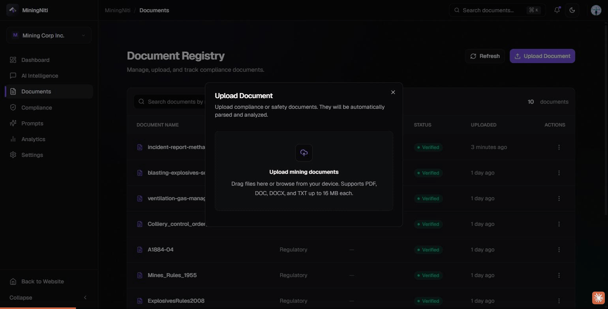
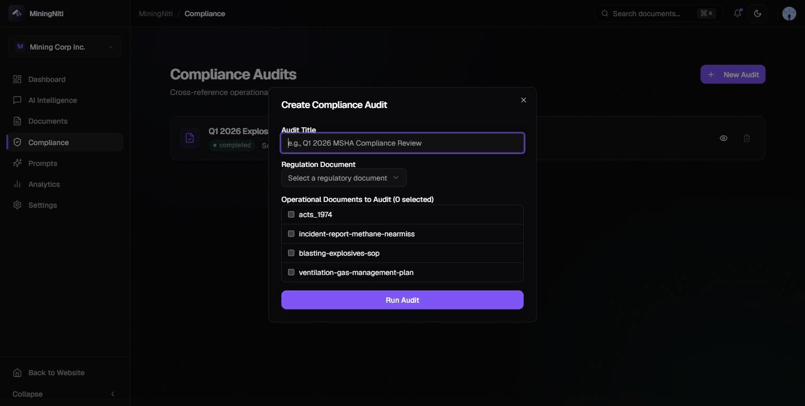
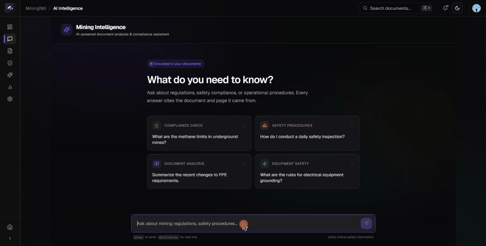
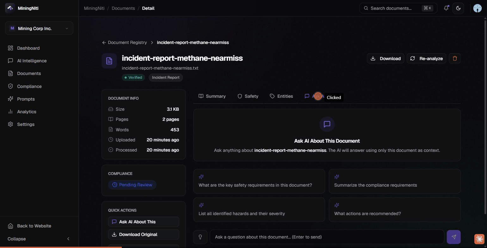
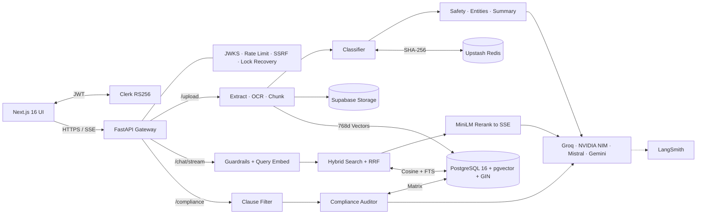
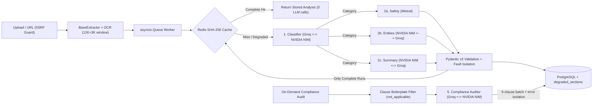
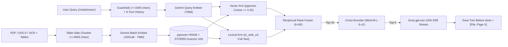

<div align="center">

```
 ███╗   ███╗██╗███╗   ██╗██╗███╗   ██╗ ██████╗     ███╗   ██╗██╗████████╗██╗
 ████╗ ████║██║████╗  ██║██║████╗  ██║██╔════╝     ████╗  ██║██║╚══██╔══╝██║
 ██╔████╔██║██║██╔██╗ ██║██║██╔██╗ ██║██║  ███╗    ██╔██╗ ██║██║   ██║   ██║
 ██║╚██╔╝██║██║██║╚██╗██║██║██║╚██╗██║██║   ██║    ██║╚██╗██║██║   ██║   ██║
 ██║ ╚═╝ ██║██║██║ ╚████║██║██║ ╚████║╚██████╔╝    ██║ ╚████║██║   ██║   ██║
 ╚═╝     ╚═╝╚═╝╚═╝  ╚═══╝╚═╝╚═╝  ╚═══╝ ╚═════╝     ╚═╝  ╚═══╝╚═╝   ╚═╝   ╚═╝
```

### Multi-Agent Document Intelligence & Hybrid RAG Platform for Mining Compliance

[](https://python.org)
[](https://docs.astral.sh/uv/)
[](https://fastapi.tiangolo.com)
[](https://nextjs.org)
[](https://supabase.com)
[](LICENSE)

[**Live App (`miningniti.vercel.app`)**](https://miningniti.vercel.app)

[Overview](#overview) · [Project History](#project-history) · [Live Demo](#live-demo) · [Engineering Decisions](#key-engineering-decisions) · [Architecture](#architecture) · [Quick Start](#quick-start) · [Evaluation & Testing](#evaluation--testing) · [Trade-offs](#trade-offs--known-limitations) · [API & Structure](#api--project-structure)

---

<table>
  <tr>
    <td align="center" width="520">
      <br/>
      <strong>Ministry of Coal problem statement</strong><br/>
      <sub>Recognized by Coal India Limited &amp; CMPDI<br/>
      See <a href="#project-history">Project history</a> — the 2023 winning entry was a<br/>
      separate team prototype; this repository is an independent rebuild.</sub>
    </td>
  </tr>
</table>

</div>

---

## Overview

**MiningNiti** is a full-stack AI backend and document intelligence workspace built for mining safety regulations (MSHA, DGMS, OSHA), operational SOPs, and incident reports. It parses PDFs, DOCX files, text, and scanned images, runs a concurrent multi-agent analysis pipeline on upload, indexes chunks into PostgreSQL (`pgvector` + full-text), serves citation-backed SSE chat over hybrid retrieval with cross-encoder reranking, and cross-checks operational documents clause-by-clause against regulations.

### Project history

The original entry won **Smart India Hackathon 2023** (Ministry of Coal, judged by CMPDI) as a team prototype. **This repository is an independent, ground-up solo rebuild started in June 2025**—none of the 2023 hackathon code carried over.

<details>
<summary><b>Click to expand full Project History &amp; 2023 Prototype vs. Rebuild Comparison</b></summary>

**Two separate builds — hackathon prototype vs. independent ground-up rebuild.**

The original entry was built for **Smart India Hackathon 2023** (Nov–Dec 2023) against the Ministry of Coal problem statement, by a team, and **won at the national level**. CMPDI officials who judged the finals initiated follow-up discussions about deploying it at scale; those talks did not proceed. It was never deployed at CMPDI, and there is no ongoing institutional relationship.

**This repository is not that codebase.** It is an independent, ground-up rebuild started in **June 2025** and developed solo since — a production system rather than a hackathon prototype. None of the 2023 code carried over, and that prototype was never under version control in a repository I can point to.

|  | Origin | This repository |
|---|---|---|
| **When** | Nov–Dec 2023 | June 2025 – present |
| **Who** | Team (SIH 2023) | Sole developer |
| **Status** | Hackathon prototype | Live, deployed, continuously integrated |

#### What changed

> **Note:** the *Origin* column is from recollection — that prototype predates this repository and its code is not available to verify against. Every claim in the *This repository* column is checkable in the code.

|  | SIH 2023 prototype | This repository |
|---|---|---|
| **Architecture** | Single-pass RAG chatbot, built on LangChain | 5 specialized agents — 4 running concurrently on upload, plus an on-demand compliance auditor |
| **Orchestration** | LangChain chains | No agent framework — orchestration is hand-written on `asyncio.gather` with per-agent error isolation, quota-aware provider failover, and a content-addressed result cache |
| **Retrieval** | FAISS vector search | Hybrid: `pgvector` cosine + PostgreSQL full-text, fused with Reciprocal Rank Fusion, then cross-encoder reranked (`top-20 → top-5`) |
| **Models** | Open-source model with DPO, Gemini-backed | 3 LLM providers (Groq, NVIDIA NIM, Mistral) with quota-aware automatic failover; Gemini for embeddings |
| **Evaluation** | — | Hit Rate@k / MRR / Recall@k / nDCG@k harness over a labelled golden set, running as a **blocking CI gate**; LangSmith tracing on the orchestrator, retrieval, and chat |
| **Security** | — | Clerk JWT (RS256-pinned, JWKS caching, `azp` validation), prompt-injection guardrails, DNS-resolving SSRF guard, 120 req/min rate limiting |
| **Tests** | — | 321 unit tests (380 collected, including integration and eval suites) |
| **Stack** | Python backend, TypeScript frontend | FastAPI + PostgreSQL/pgvector (Python 3.14, `uv`) · Next.js 16 / React 19 |
| **Deployment** | Local | Live on free-tier infrastructure, auto-deployed from `main` |

</details>

---

## Live Demo

<sub>Frontend is hosted on Vercel and the FastAPI backend runs on a free-tier HuggingFace Docker Space (kept warm by a scheduled ping; cold starts after idle take ~30–60s). Every recording below was captured against the live deployment.</sub>

### Multi-Agent Document Pipeline
<div align="center">



<sub><i>Upload → Classifier runs first, then Safety Analyzer, Entity Extractor, and Summarizer execute in parallel with schema-validated output.</i></sub>

</div>

### Compliance Auto-Auditor & Citation-Grounded RAG Chat
<table>
  <tr>
    <td width="50%" valign="top">
      
      <p align="center"><b>Compliance Auto-Auditor</b><br/><sub>Evaluates each clause as <code>compliant</code>, <code>gap</code>, or <code>missing</code> with cited evidence (excluding definitions via <code>not_applicable</code> and isolating quota/LLM faults as <code>error</code>).</sub></p>
    </td>
    <td width="50%" valign="top">
      
      <p align="center"><b>Hybrid RAG Chat (SSE)</b><br/><sub>Hybrid retrieval + Cross-Encoder reranking, token streaming, and strict <code>[FileName, Page X]</code> grounding (explicitly refuses unsupported claims).</sub></p>
    </td>
  </tr>
  <tr>
    <td width="50%" valign="top">
      
      <p align="center"><b>Document-Scoped Chat</b><br/><sub>Runs the same retrieval pipeline filtered to a single open document inside the viewer.</sub></p>
    </td>
    <td width="50%" valign="top">
      
      <p align="center"><b>Analytics &amp; Registry</b><br/><sub>Real-time job polling, safety scores, entity breakdown, and audit trail (see also <a href="docs/assets/documents.jpg">documents view</a>).</sub></p>
    </td>
  </tr>
</table>

---

## Key Engineering Decisions

Real failure modes shaped every major choice in MiningNiti:

- **Hand-written async orchestration instead of LangChain:** Heavy agent frameworks hide control flow and retry behavior. Running `ClassifierAgent` first (so document category informs downstream prompts) and then fanning out `SafetyAnalyzer`, `EntityExtractor`, and `Summarizer` concurrently via `asyncio.gather()` keeps latency low and isolation clean—while Pydantic v2 schemas (`_generate_structured`) coerce messy LLM string outputs into valid models instead of crashing API responses.
- **Quota-aware multi-provider routing with retries in one place:** Free-tier limits vary sharply (`Groq` caps around ~8K TPM). Routing `EntityExtractor` and `Summarizer` to **NVIDIA NIM** (`nvidia/nemotron-3.5-super-vl-120b-a12b`, with `enable_thinking: False` for fast JSON) with automatic fallback to `Groq`, while failing `Classifier` and `ComplianceAuditor` over from `Groq` to `NVIDIA NIM` on rate limits, keeps the pipeline resilient—and keeping retries strictly inside `BaseAgent._generate_json` eliminated a duplicate outer loop that used to multiply failures into up to `9` attempts per agent.
- **Content-addressed caching that refuses to cache failures:** Keying Redis by `SHA-256(extracted_text) + PIPELINE_VERSION` lets duplicate uploads and restarted jobs skip all 4 LLM calls while automatically invalidating on prompt updates. `_is_cacheable()` checks every section and never stores degraded or rate-limited runs—so clicking *Re-analyze* genuinely retries rather than replaying a cached error for 7 days.
- **Loud degradation instead of silent data corruption:** Re-analyzing skips re-extraction and re-embedding if chunk vectors already exist; partial agent failures save healthy sections alongside `processing_error` and `degraded_sections`; compliance quota errors are isolated as `status="error"` instead of inflating `missing` gaps; and `/api/v1/health` runs 60s-cached 1-token LLM pings rather than assuming `.env` keys work.
- **Replacing silent `pg_trgm` zero-rows with `tsvector` + direct arm guards:** The original lexical arm matched `pg_trgm`'s `%` operator against 1,000-char chunks, scoring ~`0.13` below its `0.30` threshold and silently returning zero rows for months while cross-encoder reranking masked the gap on small test sets. Switching to a `STORED` `tsvector` GIN index (`ts_rank_cd`) plus direct CI guards on lookalike clauses (`30 CFR 75.323` vs `75.400`) proves both retrieval arms stay alive.
- **Table-aware chunk splitting & locked 768-dim embeddings:** Mining regulations contain long tables without sentence periods—one 400-row table produced a `14,703`-char chunk that Gemini silently truncated. Splitting Markdown tables cleanly under `MAX_CHUNK_CHARS=4000` with repeated headers preserves every row, and setting `output_dimensionality=768` stops `gemini-embedding-001` (default `3072` dims) from failing `pgvector` inserts.
- **One turn lifecycle for sync and streaming chat:** Routing both `/chat/send` and `/chat/stream` through `prepare_turn()` and `finalize_turn()` applies identical guardrails (`23` injection regexes, `1,500`-char cap), loads bounded history (`6` turns / `6,000` chars) *before* saving the incoming user turn to avoid SQLAlchemy autoflush prompt echo, and persists streamed replies before sending `done` + `session_id`.
- **Advisory-lock crash recovery & hardened security edges:** Startup `scripts.migrate` runs Alembic + ensures HNSW/GIN indexes, then a PostgreSQL advisory lock (`pg_try_advisory_lock`) elects one worker to re-queue interrupted jobs cleanly across container restarts. Auth pins `PyJWT` to `RS256` + `azp` (avoiding `python-jose` CVEs), URL ingestion checks `ip.is_global` (blocking CGNAT `100.64/10` missed by legacy `is_private`), and config validators strip pasted newlines from API keys and fail fast on malformed `CLERK_JWKS_URL`s.

---

## Architecture

### System Overview



### Multi-Agent AI Pipeline



### Hybrid RAG Architecture



### Tech Stack

| Layer | Technologies |
|---|---|
| **Backend** | Python 3.14+, `uv`, FastAPI, Pydantic v2, SQLAlchemy 2.0, Alembic, `slowapi`, Gunicorn/Uvicorn |
| **AI & Retrieval** | Groq (`openai/gpt-oss-120b`), NVIDIA NIM (`nvidia/nemotron-3.5-super-vl-120b-a12b`), Mistral (`magistral-small-latest`), Google Gemini (`gemini-embedding-001`, eval judge `gemini-3.7-flash`), `sentence-transformers` (`ms-marco-MiniLM-L-6-v2`), LangSmith |
| **Data & Auth** | Supabase PostgreSQL 16 (`pgvector`, `pg_trgm`), Upstash Redis, Supabase Storage, Clerk (RS256 JWKS) |
| **Frontend** | Next.js 16 (App Router, Turbopack), React 19, TypeScript, Tailwind CSS v4, shadcn/ui, TanStack React Query, Zustand, Recharts, `react-pdf` |
| **CI/CD** | GitHub Actions (`uv` lint/test/eval, `next build`, Docker build validation, auto-deploy to HuggingFace Spaces) + Vercel |

---

## Quick Start

### Prerequisites

- **Docker & Docker Compose** (easiest full-stack local setup), **or** for manual runs: **Python 3.14+**, [**uv**](https://docs.astral.sh/uv/), and **Node.js 24+** (`frontend/.nvmrc`).
- For local OCR and MIME sniffing without Docker: `tesseract-ocr`, `poppler`, and `libmagic`.
- Free API accounts: PostgreSQL with `pgvector` (or Supabase), Clerk, Gemini, Groq, and Mistral (plus optional NVIDIA NIM, Redis, and Supabase Storage).

### 1. Configure Environment

```bash
git clone https://github.com/Iammilansoni/MiningNiti.git
cd MiningNiti

cp backend/.env.example backend/.env
cp frontend/.env.example frontend/.env.local
```

### 2. Run with Docker Compose (Recommended)

```bash
docker compose up -d
```

Starts PostgreSQL (`pgvector/pgvector:pg16`), Redis, FastAPI backend (`http://localhost:8000`), and Next.js frontend (`http://localhost:3000`), automatically running migrations via `scripts.migrate`.

### 3. Manual Setup (`uv` + Next.js)

```bash
# Backend
cd backend
uv sync
uv run python -m scripts.migrate     # applies Alembic migrations & creates HNSW/GIN indexes
uv run uvicorn app.main:app --reload --port 8000
```

```bash
# Frontend
cd frontend
npm install
npm run dev
```

<details>
<summary><b>Environment Variables Reference</b> (full comments in <code>backend/.env.example</code> &amp; <code>frontend/.env.example</code>)</summary>

| Variable | Side | Required | Purpose |
|---|---|---|---|
| `DATABASE_URL` | Backend | Yes | PostgreSQL + `pgvector` URI (use Supabase Transaction Pooler port `6543` in prod) |
| `GEMINI_API_KEY` | Backend | Yes | Gemini embeddings (`gemini-embedding-001`) and eval judge |
| `GROQ_API_KEY` | Backend | Yes | Classifier, Compliance Auditor, and RAG chat generation |
| `MISTRAL_API_KEY` | Backend | Yes | Safety Analyzer agent (`magistral-small-latest`) |
| `CLERK_JWKS_URL` | Backend | Yes | Clerk JWKS endpoint for RS256 JWT verification |
| `NVIDIA_API_KEY` / `NVIDIA_MODEL` | Backend | Recommended | Entity Extractor, Summarizer, and Groq quota failover via NVIDIA NIM (`nvidia/nemotron-3.5-super-vl-120b-a12b`; app boots without it) |
| `CLERK_AUTHORIZED_PARTIES` | Backend | Recommended | JSON list of allowed frontend `azp` origins |
| `CORS_ORIGINS` / `CORS_ORIGIN_REGEX` | Backend | Recommended | Allowed browser origins for self-hosted deployments |
| `REDIS_URL` | Backend | Optional | Content-addressed analysis cache (`rediss://` for Upstash TLS — no `?tls=true`) |
| `SUPABASE_URL`, `SUPABASE_SERVICE_KEY`, `SUPABASE_STORAGE_BUCKET` | Backend | Optional | Durable upload storage across container restarts (falls back to local disk) |
| `NEXT_PUBLIC_API_BASE_URL` | Frontend | Yes | FastAPI base URL (no trailing slash) |
| `NEXT_PUBLIC_CLERK_PUBLISHABLE_KEY`, `CLERK_SECRET_KEY` | Frontend | Yes | Clerk frontend auth keys (`CLERK_SECRET_KEY` stays server-side only) |

</details>

---

## Evaluation & Testing

The backend test suite spans **375 collected tests** across unit tests (SQLite in-memory + mocked providers), real PostgreSQL integration tests, retrieval quality metrics/harness, and Gemini-judged generation evals:

```bash
cd backend

# Fast offline suite (unit + regression + 59 pillar architecture tests + metric math)
uv run pytest tests/unit/ tests/eval/test_retrieval_metrics.py -v -m unit
uv run python -m unittest discover -s tests/unit -p "test_pillar*.py" -v

# Formatting & import checks
uv run black --check app/ tests/
uv run isort --check-only app/ tests/

# Real PostgreSQL + pgvector suites (start postgres container first)
docker compose up -d postgres
uv run pytest tests/integration/ -v -m integration
uv run pytest tests/eval/test_retrieval_eval.py -v -m retrieval

# Gemini-judged generation eval (requires live GEMINI_API_KEY; live suite also needs Groq + DB)
uv run pytest tests/eval/test_rag_eval.py -v -m synthetic
uv run pytest tests/eval/test_rag_eval.py -v -m live
```

### Retrieval Quality Gate (CI-Enforced)

Evaluated deterministically in CI against a labelled 130-chunk mining corpus (`12` queries) using `all-MiniLM-L6-v2` so retrieval regressions fail builds without external API keys:

| Metric | What It Checks | CI Floor | Measured |
|---|---|---|---|
| **Hit Rate@5** | Any relevant chunk in top 5 | `0.90` | `1.000` |
| **MRR** | Rank of first relevant hit | `0.75` | `1.000` |
| **Recall@5** | Fraction of relevant chunks surfaced | `0.85` | `0.958` |
| **nDCG@5** | Clustering relevant hits at top ranks | `0.75` | `0.968` |

> **Why direct arm guards matter:** During hardening, stubbing the lexical search arm to return `[]` left all four aggregate metrics unchanged because dense vector over-fetch + cross-encoder reranking compensated on a 130-chunk corpus. Direct assertions (`test_lexical_arm_returns_rows`, `test_citation_lookalikes_are_distinguished` for `30 CFR 75.323` vs `75.400`) verify the full-text arm stays functional.

**CI/CD gates (`.github/workflows/ci.yml`, `deploy.yml`):** Formatting (`black`, `isort`), Alembic migration bootstrap, unit tests, PostgreSQL integration tests, the retrieval quality gate, frontend `eslint` + `next build`, and Docker image builds (on `main`/`develop`) are blocking. `mypy` (crashes on Torch internals) and `bandit` (3 medium `B104`/`B608` findings pending triage) run non-blocking. Pushes to `main` touching `backend/**` auto-deploy to HuggingFace Spaces.

---

## Trade-offs & Known Limitations

- **Sync SQLAlchemy inside async endpoints:** Database calls use synchronous sessions, capping per-worker concurrency under heavy I/O (an unused async engine skeleton exists in `app/db/session.py` as the next refactor step).
- **In-process background queue:** Document and compliance jobs run on an in-process `asyncio.Queue` rather than Redis/Celery workers—simple to deploy on single-instance free tiers, though queued jobs don't span multiple Gunicorn replicas (interrupted rows recover on restart via Postgres advisory locks).
- **Document context windowing:** Upload agents classify/summarize from the document head + tail (`~15K` chars); full-document lookup relies on chunked RAG retrieval.
- **Lexical scoring & corpus scale:** Full-text ranking uses PostgreSQL `ts_rank_cd`, not true BM25 (`pg_search`), and the CI golden set is a directional 130-chunk corpus.
- **No frontend unit/E2E suite yet:** Backend coverage is extensive, while the Next.js frontend currently relies on TypeScript compilation, ESLint, and manual/live checks.
- **Supported formats:** PDF, DOCX, TXT, and images (PNG, JPEG, WEBP — plus TIFF/BMP when added to `ALLOWED_FILE_TYPES`) up to 50 MB.

---

## API & Project Structure

Interactive Swagger & ReDoc schemas are served at `/docs` and `/redoc`. See [ARCHITECTURE.md](ARCHITECTURE.md) for deeper system notes.

<details>
<summary><b>Click to expand REST Endpoints (<code>/api/v1</code>) &amp; Repository Layout</b></summary>

### Endpoints
- **Root / Health:** `GET /`, `GET /health` (static probe), `GET /api/v1/`, `GET /api/v1/health` (DB, Redis, 1-token LLM probes), `GET /api/v1/health/providers`
- **Documents & Upload:** `POST /api/v1/upload`, `GET /api/v1/documents`, `POST /api/v1/documents`, `GET /api/v1/documents/{id}`, `GET /api/v1/documents/{id}/file`, `GET /api/v1/documents/{id}/analysis`, `POST /api/v1/documents/{id}/reanalyze`, `DELETE /api/v1/documents/{id}`
- **Chat & RAG:** `GET/POST /api/v1/chat/sessions`, `GET/PATCH/DELETE /api/v1/chat/sessions/{id}`, `POST /api/v1/chat/send`, `POST /api/v1/chat/stream` (SSE)
- **Compliance Audits:** `GET/POST /api/v1/compliance/audits`, `GET/DELETE /api/v1/compliance/audits/{id}`, `GET /api/v1/compliance/audits/{id}/export`
- **Search, Analytics, Prompts, Jobs & Profile:** `GET /api/v1/search?q=`, `GET /api/v1/analytics/{dashboard,documents,safety,violations}`, `GET/POST /api/v1/prompts`, `GET/PUT/DELETE /api/v1/prompts/{id}`, `GET /api/v1/jobs`, `GET /api/v1/jobs/{id}`, `GET/PUT /api/v1/user/profile`

### Repository Layout
```
MiningNiti/
├── backend/
│   ├── app/
│   │   ├── agents/          # Orchestrator + 5 specialized Pydantic-validated agents
│   │   ├── api/v1/          # FastAPI routers (documents, upload, chat, compliance, search, analytics, jobs, prompts, user, health)
│   │   ├── core/            # Config, Clerk JWKS auth, SSRF guard, exceptions, sanitization
│   │   ├── db/              # SQLAlchemy session + pgvector/GIN index bootstrap
│   │   ├── models/          # ORM models (Document, DocumentEmbedding, ChatSession, ComplianceAudit, CustomPrompt, AuditLog, User)
│   │   ├── schemas/         # Pydantic v2 schemas
│   │   └── services/        # Hybrid search, reranker, extractors, chunker, cache, storage, queue, compliance
│   ├── alembic/             # Database migrations
│   ├── scripts/             # Startup migration & helper scripts
│   ├── tests/               # unit/ (321), integration/ (27), eval/ (32)
│   ├── pyproject.toml       # uv project config, CPU PyTorch index, lint settings
│   ├── uv.lock              # Locked Python 3.14 dependency graph
│   ├── Dockerfile           # Multi-stage production container
│   └── Dockerfile.hf        # HuggingFace Spaces container
├── frontend/
│   └── src/                 # Next.js 16 App Router (app/, components/, hooks/, lib/, providers/, stores/, styles/)
├── .github/workflows/       # CI (ci.yml) & HuggingFace Spaces CD (deploy.yml)
├── docker-compose.yml       # Local full-stack dev orchestration
├── docker-compose.prod.yml  # Self-hosted production stack
└── ARCHITECTURE.md          # Architectural deep dive
```

</details>

---

## Contributing & License

PRs are welcome: run `uv run black --check app/ tests/`, `uv run isort --check-only app/ tests/`, and `uv run pytest tests/unit/ -v -m unit` on `backend/`, plus `npm run lint` on `frontend/`.

Licensed under the **MIT License** — see [LICENSE](LICENSE).

<div align="center">

Built by [**Milan Soni**](https://github.com/Iammilansoni) · [](https://www.linkedin.com/in/sonimilan/) · [](https://twitter.com/Iammilansoni)

</div>
